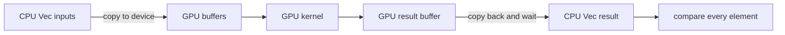

# Start here: how CUDA and Rust fit together

**Goal:** identify where code runs, who owns its memory, and which worker writes
each answer. Basic Rust is enough; the refresher below covers the relevant parts.

Run from the project root in Windows PowerShell:

```powershell
cargo run --example walkthrough
cargo run --example lab -- launch 257 256
```

These are CPU programs. The second command prints a model of CUDA indices; it
does not launch GPU threads.

## One application, two places of execution

`main` runs on the CPU, called the **host**. A **kernel** is a function compiled
for the GPU, called the **device**. In these projects, a library macro marks the
kernel and generates its host launcher. Calling an ordinary Rust function does
not automatically offload it to CUDA.



The device allocation is distinct from the input `Vec` in these examples.
Transferring data, allocating memory, and submitting work all have costs. A tiny
kernel can do little arithmetic yet take noticeable time through the full chain.
See NVIDIA's [programming model](https://docs.nvidia.com/cuda/cuda-programming-guide/01-introduction/programming-model.html)
for the language-independent terminology.

## The small amount of Rust you need

| Rust concept | Read it as | Where it appears |
| --- | --- | --- |
| `Vec<f32>` | Owned CPU array of 32-bit floats | Input generation and readback |
| `&[f32]` | Borrowed read-only slice | CPU references and SIMT kernel inputs |
| `&mut T` | Exclusive mutable borrow | Host access to output buffers |
| `Result<T, E>` and `?` | A value or an error; propagate errors | Allocation, launch, validation |
| `Arc<T>` | Shared ownership of host-side state | cuTile operation inputs |
| `const WIDTH: i32` | A value used in specialization | Tile shapes |
| `unsafe { ... }` | The programmer must uphold a stated contract | Module loading and shared memory |

For example, `DeviceBuffer::from_host(&stream, &x)?` reads CPU data and supplies a
GPU allocation. In `module.scale_add(..., &mut output, ...)`, the host wrapper
receives exclusive access to the output. The reference `saxpy` function in
`src/learning.rs` runs on the CPU and gives an independent mathematical answer.

`Arc` is an ownership tool for the host operation graph. It does not turn an
ordinary host pointer into device-accessible memory. Likewise, Rust ownership
does not prove a reduction formula or a barrier placement is correct.

## Work is arranged into threads, blocks, and a grid

In the SIMT examples, every thread executes the same kernel with different
coordinates. A block is a group of threads; a grid contains the launched blocks.
NVIDIA groups threads into **warps of 32**. A block can contain several warps;
it is not a physical GPU core, and the grid need not execute all at once.

For a one-dimensional launch:

```text
global_index = block_index * threads_per_block + thread_index
blocks = ceil(element_count / threads_per_block)

257 elements, 256 threads/block -> 2 blocks -> 512 launched threads
thread 0 of block 1 -> element 256
thread 1 of block 1 -> no real element
```

The kernel must handle these excess workers. Block scheduling order is not a
communication mechanism. Shared-memory cooperation in these lessons happens
within a block. NVIDIA's [SIMT kernel guide](https://docs.nvidia.com/cuda/cuda-programming-guide/02-basics/writing-cuda-kernels.html)
describes the hierarchy and indexing.

## What the two Rust approaches let you express

| cuda-oxide / SIMT | cuTile Rust / Tile |
| --- | --- |
| Describe each thread's scalar work | Describe operations on array fragments |
| Specify physical block dimensions | Partition tensors into logical output tiles |
| Name shared memory and barriers when needed | Let the compiler implement tile cooperation |
| Borrow host buffers into a launch | Move tensors/operations through an ownership chain |

A 128-element Tile partition is a data shape, not a request for 128 physical
threads. A SIMT launch contract of 128 threads does describe a physical block.
We use matching mathematical operations to make this distinction visible in code.

In cuda-oxide, `DisjointSlice` and typed indices constrain output access. Shared
memory still has explicit contracts. Read the [safety model](https://nvidia.github.io/cuda-rust/gpu-safety/the-safety-model.html)
and compare it to the comments on each `unsafe` block in this repository.

## Memory words used later

| Memory | Used by these lessons |
| --- | --- |
| Host memory | `Vec` values inspected by the CPU |
| Device global memory | Input/output buffers used across kernel launches |
| Shared memory | A block's temporary cooperative reduction/matrix tiles |
| Registers | Per-thread scalar state such as an accumulator |

A barrier orders cooperating threads; waiting on a stream makes device work
complete before the CPU consumes a result. These serve different scopes.

**Checkpoint:** explain why 257 elements need two 256-thread blocks, why an
ordinary `Vec` is copied, and why a kernel result needs a completed readback.
Continue to [vector addition](01-vector-add.md).
