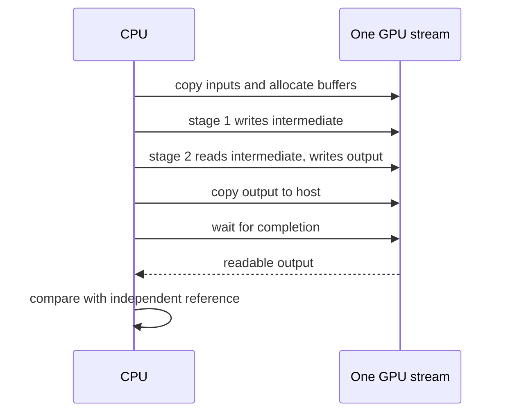

# Streams, ownership, and measuring completed work

**Goal:** connect two kernels without an intermediate CPU round trip, then
understand what an elapsed time actually measures.

```powershell
cargo run --example lab -- pipeline 257
```

In WSL Bash:

```bash
bash scripts/run_gpu.sh all pipeline 257 2
bash scripts/run_gpu.sh oxide saxpy 1048576 100
bash scripts/run_gpu.sh tile saxpy 1048576 100
```

The length is bounded to 1..=1048576 and repetitions to 1..=10000. The kernel
block/tile width remains 128; changing it also requires changing its contracts.
Read [SIMT pipeline](../gpu/oxide/src/bin/pipeline.rs) and
[Tile pipeline](../gpu/tile/src/bin/pipeline.rs).

## A stream orders dependent operations

Our pipeline computes two stages:

```text
intermediate = 2*x + y
output = 0.5*intermediate + y
```



Work submitted to one stream is ordered. Stage 2 can consume the intermediate
without a CPU readback between stages. The CPU must still wait before reading
the final answer. Different streams require explicit dependency handling when
one consumes another's output; merely creating two streams does not establish
an ordering or guarantee concurrent execution. See NVIDIA's
[asynchronous execution guide](https://docs.nvidia.com/cuda/cuda-programming-guide/02-basics/asynchronous-execution.html).

## Follow ownership in each implementation

SIMT allocates x, y, intermediate, and output once. Stage 1 borrows x/y and
mutably borrows intermediate. Stage 2 borrows intermediate/y and mutably borrows
output. Both launches use the same stream. The intermediate remains device-resident
across repetitions. The module is loaded once before measuring.

Tile builds a lazy chain. `.first().unpartition()` on stage 1 supplies an
operation producing a device tensor for stage 2; it does not copy the intermediate
to a CPU `Vec`. A second lazy copy supplies y for stage 2, making the chain easy
to follow without introducing shared device-tensor ownership APIs. The graph
keeps its inputs alive until execution and synchronization complete.

`unpartition()` changes the tensor wrapper's ownership/shape metadata. The
method name alone does not mean a host transfer. The explicit `to_host_vec`
followed by `sync_on` produces readable host data.

## Three clocks answer different questions

| Measurement | Includes | Appropriate question |
| --- | --- | --- |
| End-to-end host wall time | Allocation, copies, launches, execution, waiting | How long does this whole request take? |
| Host wall time around resident-buffer launches and a wait | Submission, execution, final synchronization | What is the cost of repeatedly submitting this workload? |
| CUDA event interval on a stream | Device timeline between recorded events | What time did the GPU spend between those events? |

The SIMT SAXPY/pipeline binaries report the second kind. Their clock starts
after warmup and input allocation/transfers, and stops after `stream.synchronize`.
Output readback and verification happen outside the interval. This is still
**host wall time**, not a pure kernel-duration measurement.

The Tile binaries report the first kind, after one completed warmup. Every
measured repetition creates an operation chain, allocates/copies, runs kernels,
and reads back. These timing scopes differ deliberately and are printed by the
programs. Do not use their numbers as an oxide-versus-Tile speed ranking.

Both warmups avoid charging first specialization/compilation to the measured
interval. Small samples remain noisy; larger inputs and repeated measurements
help, but cannot correct a mismatched timing scope. Each iteration recomputes
the same deterministic operation, so checking the final result verifies the
reported mathematical workload without timing the CPU reference.

## Next experiments

Keep the intermediate on the GPU and add a third stage. Derive a single fused
formula and implement it as a separate kernel, comparing answers first. For
general floating-point data, fusion can change rounding. Then compare like-for-like
timing scopes. Use CUDA events for a device timing exercise; this repository's
printed SAXPY/pipeline measurements use host clocks. The
[advanced track](09-advanced-gpu.md) supplies runnable CUDA-event comparisons
with matching resident-buffer timing scopes.

**Checkpoint:** explain why measuring only the return of an asynchronous launch
can miss execution, and why a shared-memory barrier cannot replace the final
CPU wait. Continue to the [capstone](08-capstone.md).
