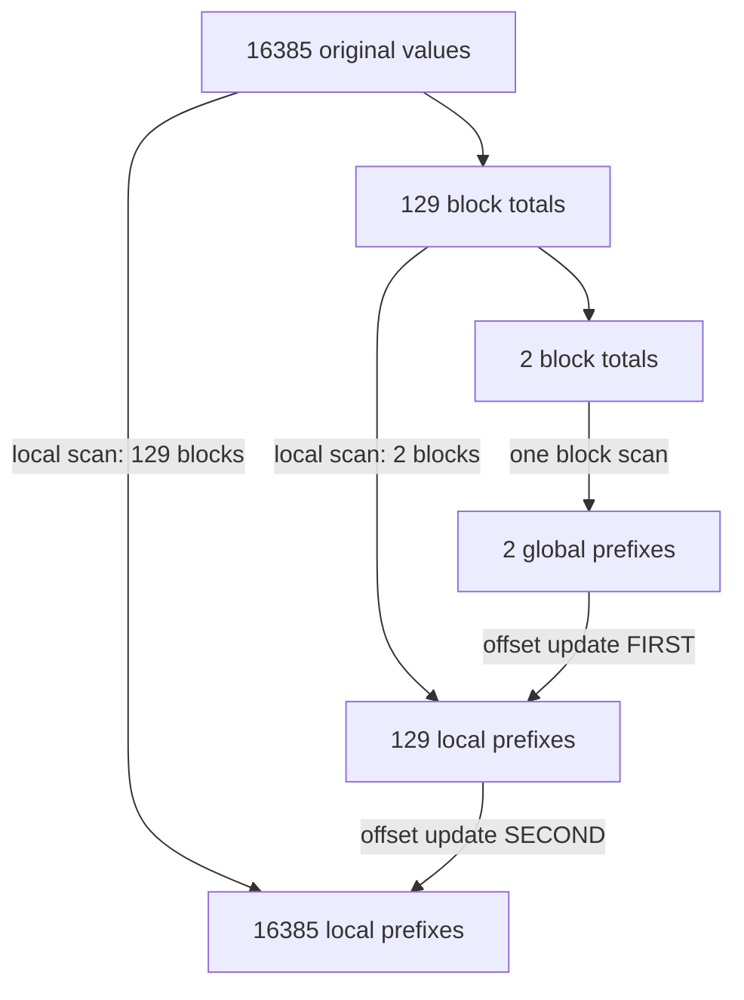

# Hierarchical exclusive scan

**Goal:** implement a global dependency using ordered kernel launches and learn
why offsets must propagate from the top of a hierarchy downward.

Read [prefix-scan.rs](../gpu/oxide/src/bin/prefix-scan.rs) and its independent
[CPU reference](../src/learning.rs). Run in WSL Bash:

```bash
bash scripts/run_gpu.sh oxide prefix-scan 129 2
bash scripts/run_gpu.sh oxide prefix-scan 16385 2
bash scripts/run_gpu.sh oxide prefix-scan 1048576 100
```

## What scan computes

An exclusive sum writes the sum of earlier elements:

```text
input:     [3,1,4,0,2]
exclusive: [0,3,4,8,8]
inclusive: [3,4,8,8,10]
```

The GPU example uses `u32` inputs `i % 7`, making comparisons exact. The CPU
reference rejects totals exceeding `u32::MAX` before launch. Because inputs are
nonnegative, a valid total also bounds each partial sum. Changing to signed or
floating-point values requires revisiting overflow, subtraction, and numerical
validation.

## A local block scan

Each block loads 128 cells into shared memory; tail cells receive zero. The
Hillis-Steele stages use offsets 1, 2, 4, 8, 16, 32, 64. At each stage a lane
reads its current value and, if present, its predecessor at that offset. Their
sum becomes the next stage's value. Afterward, subtracting the original input
converts each inclusive result to an exclusive result. Lane 127 writes the
block's total, including any zero-padded tail.

There are **two barriers per stage**. The first ensures every lane finishes
reading the old stage before any lane overwrites it; the second makes the new
stage ready for the next reads. Keeping only a barrier after the writes would
allow an inter-warp read/write race. Every physical thread reaches both barriers.

For a block width B, this local scheme performs O(B log B) additions. A Blelloch
up-sweep/down-sweep uses O(B) additions and is a useful next implementation.
NVIDIA's [scan chapter](https://developer.nvidia.com/gpugems/gpugems3/part-vi-gpu-computing/chapter-39-parallel-prefix-sum-scan-cuda)
explains both algorithms and the hierarchical extension. This baseline uses a
fixed B=128, prioritizing a readable synchronization proof.

## Local prefixes need global offsets

A block-local result starts at zero even if earlier blocks contain values.
Globally, each local result needs the sum of all preceding block totals. Scan
the totals to obtain those offsets. If the totals themselves span several
blocks, repeat the same process.

For 16,385 inputs, the local scan lengths are `[16385,129,2]`:



The upward phase launches all local scans. The downward phase first makes
the 129-element prefix array global using the two-element array, then updates
the original prefixes. Reversing those two offset launches leaves missing
contributions in the original output. Lengths at or below 16,384 would not
expose that particular bug because only one offset level is needed.

With L local levels there are L scan launches and L-1 offset launches. The final
scalar total is allocated as a byproduct but is not scanned again. All launches
use one stream; no ordinary block assumes another block has run or waits for it
inside a kernel. Allocation and launches remain host-orchestrated.

## Rust expresses two separate hierarchies

`inputs[level]` holds original values or block totals. `scans[level]` holds
prefixes. The scan writes both a prefix allocation and the next totals
allocation. `split_at_mut` separates producer/consumer containers without
aliasing mutable buffers. During descent, the next prefix array is borrowed
read-only while the lower prefix array is mutable.

Repetitions first overwrite every local prefix and total before adding offsets.
They therefore do not accidentally accumulate offsets from earlier iterations.
Allocations, transfers, warmup, and result validation are outside the CUDA event
interval. Every returned integer prefix is checked exactly, including tails.

## Checkpoints and next projects

1. For `[3,1,4,0,2]` and a conceptual width of two, block totals are `[4,4,2]`;
   offsets are `[0,4,8]`. Explain how local prefixes become `[0,3,4,8,8]`.
2. Predict levels for length 129: `[129,2]`, two scan launches and one offset
   launch. For 16,385: three scan launches and two offset launches.
3. Why is the final tail block total valid? All 128 cells are initialized and
   unused cells are zero, so the final inclusive cell includes every real input.
4. Replace the local algorithm with Blelloch while preserving the host hierarchy.
   Keep tests for length 1, 127, 128, 129, 16,384, 16,385, and 1,048,576.
5. Build stable stream compaction: scan keep/drop flags, scatter kept values to
   their prefix positions, and derive the output count. Two kept elements must
   never obtain the same destination.

Scan becomes a building block for compaction and sorting in the
[continuing roadmap](ROADMAP.md). Next, connect numerical kernels into a
[complete classifier](12-gpu-classifier.md).
